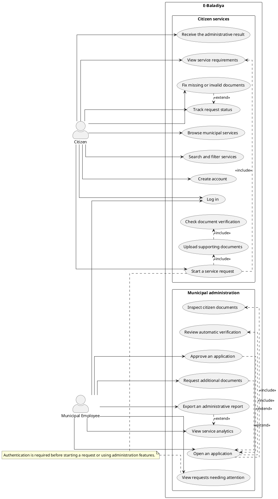

# E-Baladiya Use Case Diagram

This diagram describes the use cases represented by the current E-Baladiya
frontend. It covers the two primary actors: citizens using municipal services
and municipal employees reviewing requests.

The standalone PlantUML source is available in
[use-case-diagram.puml](./use-case-diagram.puml).

## Actor responsibilities

| Actor | Responsibilities represented in the current application |
|---|---|
| Citizen | Discover a municipal service, understand its requirements, create or access an account, submit documents, follow verification, track requests, and correct document issues. |
| Municipal Employee | Monitor the review queue, inspect applications and documents, assess automatic verification results, request more information, approve applications, and consult operational analytics. |

## Main citizen scenario

1. The citizen browses or searches the service catalogue.
2. The citizen opens a service and reviews eligibility, fees, issuing authority, and required documents.
3. The citizen logs in or creates an account.
4. The citizen starts a request and uploads the required supporting documents.
5. E-Baladiya checks the documents and displays the verification state.
6. The citizen tracks the request timeline.
7. If a document issue is found, the citizen uploads a correction.
8. The citizen receives the completed administrative result.

## Main employee scenario

1. The municipal employee logs in to the administration portal.
2. The employee views requests awaiting review or requiring attention.
3. The employee opens an application and inspects the citizen information and uploaded documents.
4. The employee reviews automatic checks such as authenticity, template matching, trusted issuer, and database matching.
5. The employee either requests additional documents or approves the application.
6. The employee uses analytics to monitor request volume, verification success, and processing time.
7. The employee can export an administrative report.

## Current implementation status

The diagram captures the intended behavior visible in the existing frontend.
The current project is a Django template prototype: routes render pages and
service data is stored in Python dictionaries, but authentication, persistence,
file uploads, verification, employee actions, notifications, and report
exporting are not yet connected to backend workflows.
